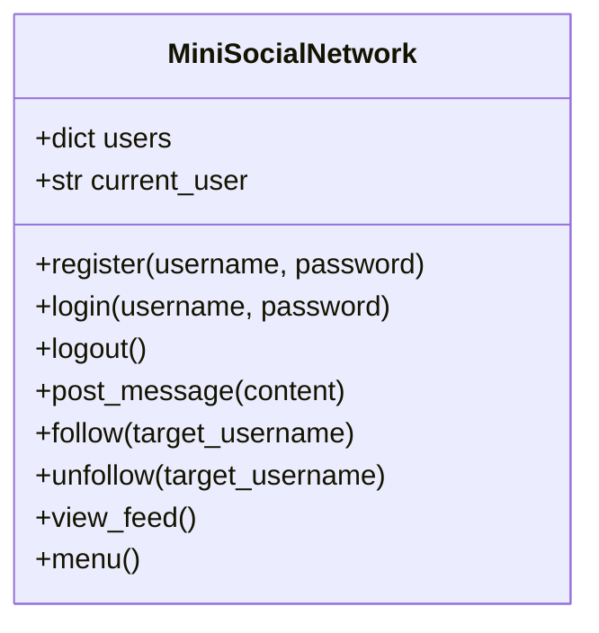

# 🌐 Project 3: Mini Social Network

> **An Object-Oriented CLI Social Media Platform Simulation**  
> *Simulates user authentication, posting messages, follow/unfollow social graphs, and a real-time chronological newsfeed using Python OOP.*

[](https://www.python.org/)
[](LICENSE)

---

## 📌 Project Overview

The **Mini Social Network** is an Object-Oriented Python application that models the core features of social media platforms like Twitter/X. It provides full user authentication, stateful sessions, social graphs (following/unfollowing), and an aggregated timeline feed sorted by newest post first.

---

## 🌟 Key Features

- 🔐 **User Authentication**: Secure registration and password-protected login sessions.
- 👤 **Session State Management**: Dynamic menus that adapt depending on whether a user is logged out or logged in.
- ✍️ **Post Messages**: Create and publish status updates tagged with the author's username and real-time timestamp.
- 🤝 **Social Graph (Follow / Unfollow)**: Follow other registered users using Python `set` collections to ensure uniqueness without duplicates.
- 📰 **Aggregated Newsfeed**: Merges posts from the current user and all followed accounts, sorting them in reverse-chronological order (newest on top).

---

## 🏗️ Code Architecture & OOP Design

The core logic is encapsulated within the `MiniSocialNetwork` class:



### Data Schema (`self.users`):
```python
self.users = {
    "alice": {
        "password": "secret_password",
        "posts": [
            {
                "user": "alice",
                "content": "Hello World!",
                "timestamp": datetime(2026, 10, 29, 14, 30, 0)
            }
        ],
        "following": {"bob", "charlie"}  # Set of followed usernames
    }
}
```

---

## 🚀 How to Run

### 1. Requirements
- Python 3.8+ (No external third-party libraries required; uses Python standard library `datetime`).

### 2. Execution
Run the script directly:
```bash
python mini_social_network.py
```
*(Or from the repository root: `python "Project 3- Mini_Social_Network.py"`)*

---

## 💻 Sample Interactive Session

```text
=== Mini Social Network ===
1. Register
2. Login
3. Exit
Choose an option: 1
Username: alice
Password: pass123
User 'alice' registered successfully.

=== Mini Social Network ===
1. Register
2. Login
3. Exit
Choose an option: 2
Username: alice
Password: pass123
Welcome, alice!

Logged in as @alice
1. Post Message
2. Follow
3. Unfollow
4. View Feed
5. Logout
Choose an option: 1
Enter message: Building an AI project today!
Post created.

Logged in as @alice
1. Post Message
2. Follow
3. Unfollow
4. View Feed
5. Logout
Choose an option: 4

--- Your Feed ---
 [2026-10-29 16:30:15]--@alice: Building an AI project today!

Logged in as @alice
1. Post Message
2. Follow
3. Unfollow
4. View Feed
5. Logout
Choose an option: 5
User 'alice' logged out.
```

---

## 🧠 Concepts Demonstrated

- Object-Oriented Programming (OOP: Classes, Encapsulation, State)
- Relational Data Modeling using Nested Dictionaries & Sets
- Session & Authentication State Handling
- Multi-source List Merging & Reverse Sorting (`sort(reverse=True)`)
- Dynamic Dual-State CLI Menu Architecture
