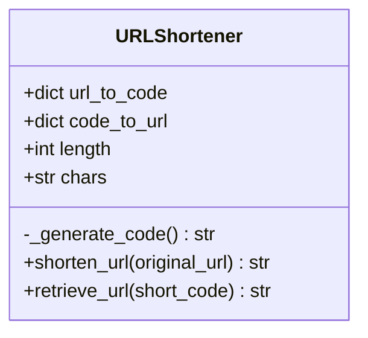

# 🔗 Project 4: Short URL Maker

> **An In-Memory URL Shortener & Base62 Code Generator**  
> *Translates long URLs into compact 6-character short codes with bidirectional mapping, collision handling, and caching.*

[](https://www.python.org/)
[](LICENSE)

---

## 📌 Project Overview

The **Short URL Maker** demonstrates the core system design architecture behind real-world URL shorteners like Bitly and TinyURL. It generates a 6-character alphanumeric key (Base62) for any given URL, guarantees collision-free unique mappings, and enables instant $O(1)$ lookups in reverse.

---

## 🌟 Key Features

- ✂️ **URL Shortening**: Converts long web URLs into compact 6-character keys (e.g. `https://example.com/very/long/path` ➡️ `xK9pL2`).
- 🔀 **Bidirectional In-Memory Mapping**:
  - `url_to_code`: Ensures identical URLs always reuse their previously generated short code (idempotent caching).
  - `code_to_url`: Resolves the short code back to the original URL in $O(1)$ time complexity.
- 🎲 **Base62 Character Encoding**: Combines lowercase letters, uppercase letters, and digits (`[a-zA-Z0-9]`), offering $62^6 \approx 56.8 \text{ billion}$ unique combinations.
- 🛡️ **Collision Avoidance**: Automatically checks if a generated code already exists and regenerates until an unused key is secured.

---

## 🏗️ Code Architecture & Class Design



| Method | Role |
|---|---|
| `_generate_code()` | Generates a randomized 6-character string from Base62 characters (`a-z`, `A-Z`, `0-9`). |
| `shorten_url(url)` | Returns the existing code if already shortened; otherwise generates a unique code, stores both mappings, and returns the key. |
| `retrieve_url(code)` | Looks up the original URL associated with the short code in $O(1)$ time. |

---

## 🚀 How to Run

### 1. Requirements
- Python 3.8+ (No external third-party libraries required; uses Python standard library `random` and `string`).

### 2. Execution
Run the script directly:
```bash
python short_url_maker.py
```
*(Or from the repository root: `python "Project 4- Short URL Maker.py"`)*

---

## 💻 Sample Interactive Session

```text
--- URL Shortener ---
1. Shorten a URL
2. Retrieve original URL from short code
3. Exit
Enter your choice : 1
Enter a URL to shorten: https://github.com/akshaykaygude/Python_Projects
Shortened code for 'https://github.com/akshaykaygude/Python_Projects' is: 8fQk2Z

--- URL Shortener ---
1. Shorten a URL
2. Retrieve original URL from short code
3. Exit
Enter your choice : 2
Enter the short code: 8fQk2Z
Original URL: https://github.com/akshaykaygude/Python_Projects

--- URL Shortener ---
1. Shorten a URL
2. Retrieve original URL from short code
3. Exit
Enter your choice : 3
Exiting program.thank you
```

---

## 🧠 Concepts Demonstrated

- Hash Table & Dictionary Lookups ($O(1)$ Time Complexity)
- Base62 Space Combinatorics & Alphanumeric Permutations
- Collision Detection & Idempotent Caching
- Clean Object-Oriented Class Encapsulation
